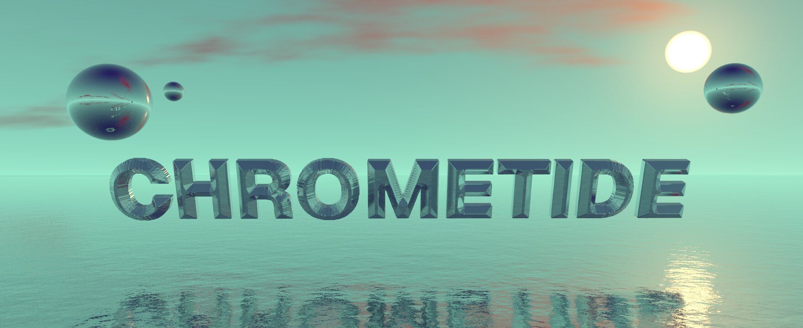

<div align="center">



# Crycer

**Bryce-style surreal 3D landscapes, in your browser. Plus the original 1997 Bryce 3D, running natively on Arch Linux, with no Docker.**

<h3><a href="https://thatpikaga.github.io/Crycer/">▶ Open Crycer in your browser</a></h3>

</div>

Crycer brings together two projects that each tried to bring back [Bryce](https://en.wikipedia.org/wiki/Bryce_(software)), the 90s program known for chrome spheres, hazy skies and endless seas:

| | What it is | How you run it |
|---|---|---|
| **Crycer (web)** | A ray tracer written from scratch, based on [Chrometide](https://github.com/denonmaryland/chrometide). It makes Bryce-style worlds live in a browser tab. | Open the link above. There is nothing to install. |
| **Crycer Classic** | The real **Bryce 3D (1997)**, unpacked from *your own* CD image and run through Wine directly on your desktop. It uses the same approach as [BryceDock](https://github.com/RaymonDev/BryceDock), without Docker, VNC or a container. | `./crycer classic Bryce3DCD.iso` once, then `crycer classic` |

---

## 1. The web app (easiest)

**Open <https://thatpikaga.github.io/Crycer/>** in a current Chrome, Chromium, Edge or Firefox. Your graphics card needs WebGL2, which nearly every PC from the last ten years has. After the first visit it also works offline, and you can install it as an app from the browser's address bar.

What you can do with it:

- **Live ray tracing.** Mirror reflections, glass, soft shadows, depth of field and bloom. The picture sharpens while you watch.
- **50 ready-made worlds, 45 skies and 22 materials.** Or roll the dice and lock the parts you like.
- **16 shapes** that can cut holes in each other or melt together. You can also sculpt islands and mountains by hand, or turn a picture into land.
- **3D lettering**, plus album cover, flyer and poster layouts.
- **Music videos.** Drop in a song and the world moves to the beat.
- **1994 mode**, which draws the picture line by line on a glowing 640×480 screen.
- **Share any world as a link.** You can also import `.glb` and `.obj` models, and export `.glb`, `.obj` or a height map.

### Run the web app locally on Arch / Omarchy

```bash
git clone https://github.com/ThatPikaga/Crycer
cd Crycer
./crycer            # installs Node if needed, builds once, opens http://127.0.0.1:5192
./crycer install    # optional: adds `crycer` to your PATH and Crycer to your app launcher
```

On any other OS, install [Node 22+](https://nodejs.org) and run `npm install && npm run dev`. `npm run build` produces a plain `dist/` folder you can host anywhere, even from a USB stick.

## 2. Crycer Classic: the original Bryce 3D on Arch Linux

You need your own **`Bryce3DCD.iso`** and serial number. Crycer does not include Bryce 3D. It only unpacks the CD image you give it.

```bash
./crycer classic ~/Downloads/Bryce3DCD.iso   # one time: installs wine + tools, unpacks, sets up Wine
crycer classic                               # every time after: starts Bryce 3D
```

The setup command does the following:

1. Installs `wine` and `libarchive` with pacman (sudo asks once). If multilib is on, it adds `lib32-mesa`.
2. Builds [unshieldv3](https://github.com/wfr/unshieldv3), which unpacks the InstallShield 3 archive so the 16-bit installer never has to run.
3. Unpacks Bryce into `~/.local/share/crycer/classic/` and copies the CD's libraries, sample scenes and manual.
4. Creates a Wine prefix and maps two drives: **`D:`** is the CD content, and **`E:`** is **`~/Crycer/Projects`**.

Bryce opens as a normal window on your desktop. On Hyprland/Omarchy it runs through XWayland. Save your scenes and renders to **`E:\`** (or `Bryce3D\Projects`) and they appear in `~/Crycer/Projects`. Bryce asks for your name and serial the first time it starts.

**Tips**

- On Hyprland, Bryce's small preset pop-ups can behave better as floating windows. Run `hyprctl clients` to find Bryce's window class, then add a `windowrulev2 = float, class:^(<that class>)$` rule.
- Run `crycer doctor` to see what is installed and what is missing.
- Settings: `CRYCER_PROJECTS` (projects folder), `CRYCER_WINEPREFIX` (Wine prefix) and `CRYCER_PORT` (web port, default 5192).
- Classic mode needs an x86_64 PC. The web app runs on anything with a modern browser.

## Commands

```
crycer                  open the web app
crycer classic <iso>    set up the original Bryce 3D from your CD image
crycer classic          start the original Bryce 3D
crycer install          add crycer to PATH and to the app launcher
crycer uninstall        remove those (your projects are kept)
crycer doctor           show what is installed
```

## How the web app works

One fragment shader ray traces the whole picture. Shapes are signed distance fields, which is what lets them cut and melt. The land is a fractal height field and the sea is a plane that runs to the horizon. [three.js](https://threejs.org) runs the canvas, and the interface is React. A world is one small JSON document, which is why it fits in a link.

| Folder | Contents |
|---|---|
| `src/engine/` | The ray tracer, the world format, worlds and skies |
| `src/engine/shapes/` | One file per shape |
| `src/features/` | Modes: 1994, word worlds, screensaver, island, photo, fly, time-lapse |
| `src/design/` | Covers, flyers and mock-ups |
| `src/ui/` | The interface |
| `mcp/` | An MCP server and CLI so AI agents can build and render worlds |
| `crycer` | The Arch Linux launcher (web + classic) |

## Credits and licence

- The web app is a fork of **[Chrometide](https://github.com/denonmaryland/chrometide)** by DeNon Maryland (MIT). See [LICENSE](LICENSE) and [NOTICE.md](NOTICE.md).
- Crycer Classic follows the approach pioneered by **[BryceDock](https://github.com/RaymonDev/BryceDock)** by RaymonDev: unshieldv3, Wine, and the D:/E: drive mapping. Crycer's launcher is a separate script written for running natively, and it contains no BryceDock code.
- **Bryce** is a product and trademark of Daz 3D (originally MetaCreations). Crycer is not affiliated with or endorsed by Daz 3D. It includes no Bryce code, files, presets or serials.
